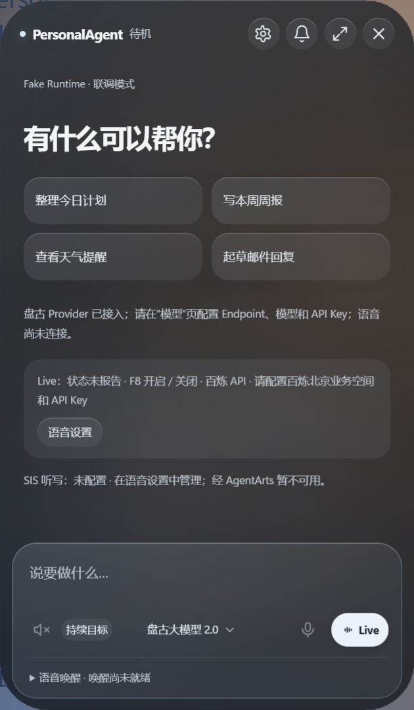
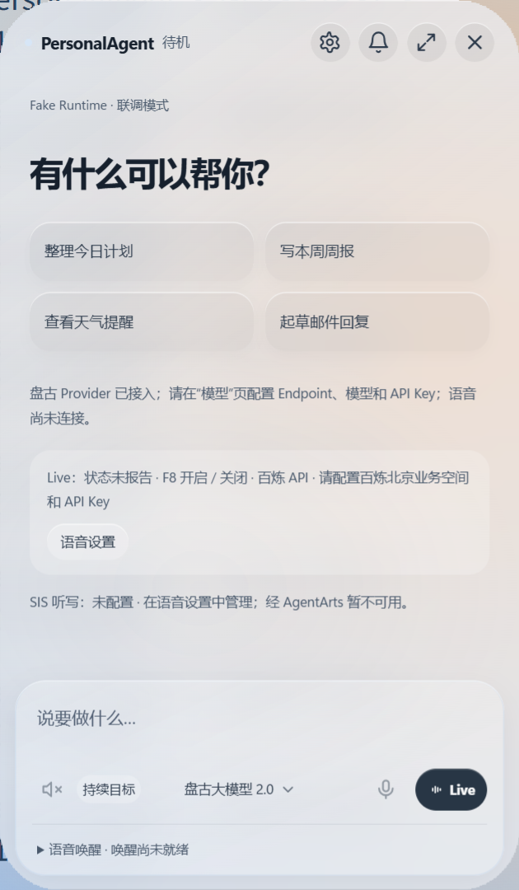

# 悬浮面板玻璃主题与原生圆角（review）

工作包 `DESKTOP-LIQUID-GLASS-20261021`，关联 MOD-11/12、PA-001/PA-002，目标 profile 为 `huawei_ict_agentarts`。用户已在实际 Windows 预览中确认深色玻璃效果，并授权提交 PR；未授权合并。交付从 `origin/main@61b05cf1` 单独整理，保留预览与其他协作者的工作区重排。

## 2026-10-22 PR #463 修复与主线同步（用户已确认，待 CI/审查）

- 远程失败基线为 `bd7b57dd`：Foundation 的 Windows CI 失败在 AgentArts Runtime 的 HTTPS deadline 测试；汇总 check 随之失败。设计审查检查是缺少非作者批准，尚无 Changes Requested，不能靠修改或跳过门禁替代批准。
- 本地合入 `main@c15855f5`，保留提交历史，解决 Renderer 导入、窗口烟测和 ROADMAP 三处冲突。主线已修正 deadline fixture：使用明确的历史期限及独立请求标记，保留“不得向模型发出请求”的断言；不在此重复修改 Runtime 或该测试。
- 保留新版授权问题卡、消息队列、引导/排队和共享模型思考选择器。新模型弹层使用现有玻璃主题变量；面板主体、原生材质和 40px 圆角不变。烟测使用新控件的可访问名称，独立用户目录隔离既有悬停设置，没有放宽状态、取消或禁用控件断言。
- 新主线完整 build、Desktop typecheck、架构 3/3、HTTPS/材质/退出回归 38/38，以及实际窗口和工作区 smoke 通过。玻璃 smoke 的 8 组主题/尺寸/缩放、草稿/菜单和原生四角像素检查通过。首次在受限进程的回环 HTTPS 测试因 `EACCES` 失败，在允许本机回环访问的环境原样重跑通过；不涉及外部账号或模型。
- 新主线集成后的完整 Desktop 回归共 1646 项：1635 通过、10 跳过、1 失败，约 166.1 秒。唯一失败仍为未修改的 Windows Host fixture 缺稳定 .NET 8 SDK；不将此环境项或未运行的远程 CI 标为通过。日志保存在工作树忽略目录 `.cache/pr463-desktop-unit.log`，其他本轮日志使用 `.cache/pr463-*` 前缀。
- 本轮使用独立 Fake 用户目录打开实际桌面预览，保留其他工作树和正在运行的工作区。用户已确认本地预览并授权更新 PR，未授权合并；远程 CI 与非作者审查仍待完成。以下 2026-10-21 的证据作为历史记录保留，不代表新主线全量结果。

## 最终行为与边界

- 面板、输入区与按钮使用连续的玻璃材质、克制的高光和一致的色系，支持原有深浅主题偏好。图片验收使用深色主题，不覆盖已有用户主题设置。
- 最外层和内容都采用 40px 圆角；移除灰色非客户区边框。对话独立滚动，输入保持高度上限，语音唤醒说明默认折叠，摘要仍显示真实状态和期限。
- 原生几何随 DPI、窗口大小和页面缩放变化；窗口命中区域保留 1 DIP 抗锯齿余量。指针高光只在事件后绘制，降低动效偏好下关闭。
- 主进程仍通过现有 Preload/IPC 提交、取消和读取任务。Runtime、AgentArts、权限、公共协议、依赖、锁文件和数据库迁移没有变化；没有纳入工作区重排或任务提交权限改动。

旧实现的 Windows `backgroundMaterial: acrylic` 会在 CSS / `setShape()` 圆角外继续绘制矩形底层。交付改为透明 HWND，系统背景为 none，在 Chromium 下方的绘图 child HWND 中放置带圆角几何裁剪的 Windows Composition HostBackdropBrush。背景模糊及染色一起裁剪，角外真实透出原背景，不使用桌面截图纹理。

## 原生绘图辅助进程与兼容

`electron/main.js` → `bindPanelMaterial()` → `startPanelBackdrop()` → `native/panel-backdrop.cs` 完成实际接线。辅助进程仅绘图，不新增 Runtime、调度器、任务库、凭据入口或网络调用。私有管道 v1 的输入仅为受信父 HWND/PID、主题和范围受限的圆角数值；助手校验 HWND 所有进程，窗口销毁或管道关闭时退出。JavaScript 仅在其自身子进程未及时退出时终止它。

Windows 11 22H2 及以上且未开启降低透明度/高对比度时启用。编译使用本机 .NET Framework 4.8、Windows SDK WinRT 引用及 GAC Numerics，按源文件哈希原子缓存到被忽略的 Desktop `.cache/panel-backdrop/`。缺少 SDK、编译失败、宿主失败或辅助功能禁用透明时，保留不透明、圆角、可读的回退。没有新增 npm 依赖或系统安装操作。

尚未制作发行包预编译资产；未在无 SDK 新机器上验收真实玻璃。这个限制明确保留，不能将开发机预览等同于跨机器发布就绪。回退依然可用，不将该绘图助手称为安全沙箱。

晚到的宿主就绪/失败回调不能覆盖已关闭窗口、辅助功能回退或替换后的视觉对象；单元覆盖这些时序。协议版本、范围校验和资源释放不影响面板外观。

退出在原有活动任务、草稿、语音等守卫确认后，先等待绘图子窗口结束，再提交最终草稿关闭边界和销毁父 HWND，避免跨进程窗口消息互等。重复退出只等待同一份释放操作；没有绕过原有退出守卫。窗口烟测通过产品 `app.quit` IPC 等到真实关闭后再结束，避免 Playwright 提前断开 Node 调试连接。工作区展开烟测使用自己的用户目录，并通过正常设置入口关闭该 fixture 的自动悬停，防止真实桌面光标并发触发展开；悬停行为仍由原窗口烟测覆盖。

## 验证与证据

执行环境为 Node 24.15.0 / npm 11.12.1。最终提交树的检查结果及合成画面记录于 [证据回执](evidence/panel-liquid-glass-20261021.json)。`panel-glass-smoke.cjs` 使用显式 Fake、隔离用户目录、实际 Electron / Preload / Renderer，并把纯合成文字/渐变场景放在面板后面。

- 深浅主题、420×720 / 420×600 / 360×600 和 125% 页面缩放；检查菜单边界、草稿、长输入、唤醒展开收起、降低动效和高对比度。
- 比较面板显示前后的四个角像素，必须与原背景一致；不能仅凭 CSS 半径、窗口尺寸或 Renderer 截图判定原生裁剪通过。
- 原生材质单元覆盖能力门禁、就绪/失败、主题/缩放、辅助功能、关闭释放及过期回调。
- 退出与 Live/任务前置检查定向回归 35 项通过；其中材质单元 7 项，包含父窗口销毁前等待子 HWND 释放。
- 窗口、工作区多窗口及实际输入交互检查使用原仓库脚本。旧窗口烟测的执行预算检查改为独立预算控件，原生推理滑块继续按模型能力禁用；没有放宽生产逻辑或断言。

测试不调用真实模型、AgentArts、语音、麦克风或外部账号，不把 Fake 当云验收。纯 UI 材质不适用华为镜像评测；未提升任何接口冻结或能力验证等级。完整 Desktop 测试若因本机缺稳定 .NET 8 SDK 失败，记录实际结果，不跳过或削弱 Windows Host fixture。

本次完整 Desktop 套件 1553 项：1543 通过、9 跳过、1 失败，约 149.4 秒。唯一失败是未修改的 `windows-host-fixture.test.mjs` 要求稳定 .NET 8 SDK，本机 `dotnet --list-sdks` 仅有 9.0.305 / 10.0.401；原断言保留，远程必要 CI 仍须通过。最终原生像素/退出、窗口烟测、工作区烟测、类型与架构检查通过，没有遗留本轮 PR 测试绘图进程。

下图为本工作包的合成场景原生截图，不含真实用户桌面或对话数据：

## 自审与责任

实际实现和接线：Codex，提交账号 `2511375597-lab`；模块归属仍按 MODULE_ASSIGNMENTS。拟审查 `Potatos498`，拟合并 `goo122`，均待实际接手；没有代签批准。PR 必须保留最新技术 CI 和任意一位非作者的有效批准。未合并，不标记模块 done。

回退方式为还原本工作包的 Desktop 代码；无数据库迁移、凭据变更或外部副作用需要补偿。原生绘图缓存是可重新生成的本地输出，不提交二进制缓存、用户数据或真实桌面内容。

参考：[Apple Liquid Glass](https://developer.apple.com/cn/documentation/technologyoverviews/adopting-liquid-glass)、[ECC 中文设计资料](https://github.com/affaan-m/ECC/blob/main/docs/zh-CN/skills/liquid-glass-design/SKILL.md)、[Web 光学效果原理](https://github.com/childrentime/liquid-glass/blob/main/LIQUID_GLASS_EFFECT_CN.md)、[Tessl 设计资料](https://tessl.io/registry/skills/github/xu-xiang/everything-claude-code-zh/liquid-glass-design)、[Microsoft HostBackdropBrush](https://learn.microsoft.com/en-us/uwp/api/windows.ui.composition.compositor.createhostbackdropbrush)、[Win32 Composition 接入](https://github.com/MicrosoftDocs/windows-dev-docs/blob/docs/uwp/composition/using-the-visual-layer-with-win32.md)。外部资料仅用于设计与实现参考。
