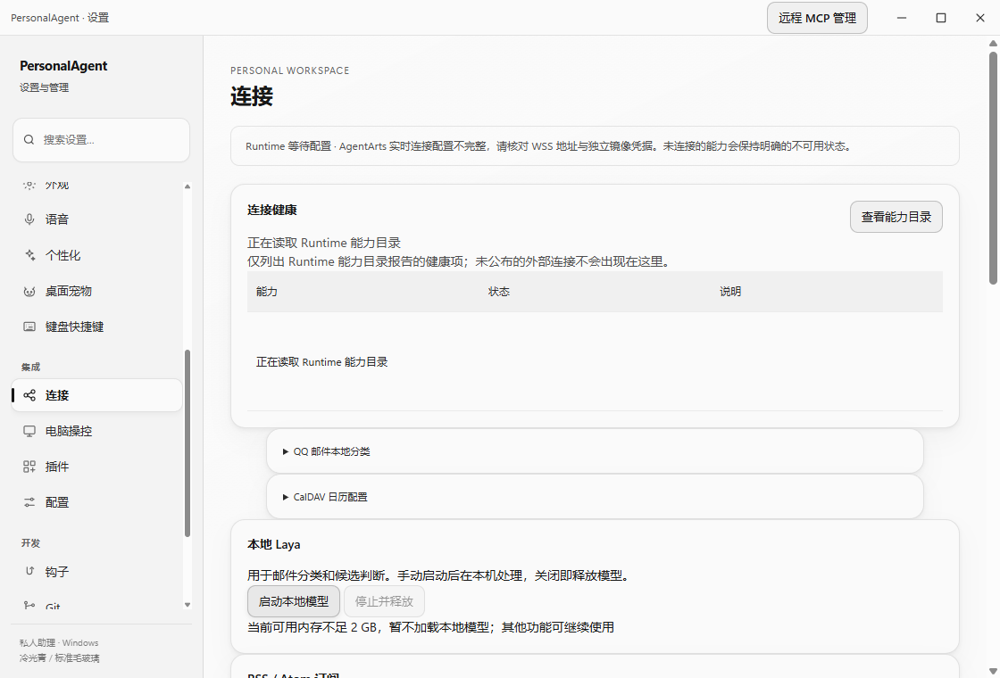

# Laya 设置按钮启动接线（2026-10-21）

目标为 `huawei_ict_agentarts` Desktop 已有的本机服务管理入口。没有新增 Local Agent 路径，也不把本机分类当作 AgentArts Golden Path 或云失败回退。分支 `codex/fix-local-model-button`，实现基线 `19ee32e1`。

## 已确认根因与修复

设置 → 连接与服务和记忆页均挂载原 `mountLayaControls`。按钮经过原 Preload、Main `desktop:action` 调用 `localLaya.start()`。原来有两个前置耦合：

1. `createDeferredRuntimeStartup` 在缺少云配置时不调用 `initializeRuntime`，Laya 宿主却只在该函数中、云 binding 校验之后创建。
2. `laya.start/stop` 与 `mail.*` 共用必须存在 `mailConfig` 的分支。

现在在云启动门之前惰性构造单个 Laya 宿主；构造不加载权重或启动进程。云配置重试复用同一宿主。Laya 管理请求独立检查原管理员 sender、Competition Profile 和宿主，邮件请求保留原配置门。原发现目录、模型身份校验、2 GiB 内存门、随机 Bearer、loopback、停止确认和退出清理均未放宽。没有公共协议、依赖、数据库或凭据迁移。

## 已执行验证与边界

Windows / Node 24.15.0 / Electron 44.2.0；独立工作树依赖、构建产物、隔离 userData。仅复用相同版本 Electron 可执行文件。测试没有使用用户现有 profile、云账号、麦克风或业务推理。

| 验证 | 结果与范围 |
| --- | --- |
| Desktop 实际静态导入依赖闭包构建、Desktop `typecheck` | 通过；非全仓 `check` |
| `laya-controls.test.mjs`、`laya-local-host.test.mjs`、`laya-main-startup.test.mjs` | 合计 17/17；补入真实外层 deferred 启动片段后 Main 3/3 再次通过。Synthetic transport/process 不是模型验收 |
| 原 Desktop `test:smoke` | 通过；隔离 Fake Runtime，验证通用窗口/Preload，未调用 Laya 模型 |
| 实际 Competition Main/Preload/Admin 点击 | Synthetic 高内存策略拒绝用例通过，页面明确显示内存不足，两处原按钮可交互，pageErrors=0。此策略是 `Number.MAX_SAFE_INTEGER`，用于确保不加载权重，不是实际 RAM 充足或不足的证明 |
| 原宿主真实现有模型启动 → health → stop | 通过；614 MiB 已有权重，CPU，`warmed=true`，`inferenceCalls=0`，`inferenceBusy=false`。仅原脚本固定公开 Synthetic 启动 warmup，未提交业务推理；显式 stop 后自己的 Python PID 和端口均退出 |
| 首次实际设置 UI 正向 ready | **failed，原因 unknown**。旧观察器只等 ready 文案，100 秒超时，未保存宿主终态。隔离 `desktop.log` 仅窗口 created/loaded，无法证明是内存拒绝或模型错误；不能用 headless 成功代替此项 |
| 新 bootstrap/观察器轻量回归 | 2/2；在 import 真实 Main 前安装本机 health 白名单，验证宿主捕获 fetch 的时序、外部/推理请求拒绝和回执脱敏。修正之前 firstWindow 后安装的观察器未覆盖已构造宿主，所以旧 UI `health=0` 计数不作为全部网络观察证据 |
| 修正观察器后的单次真实 UI 诊断 | 按原 RAM 门返回 `memory_insufficient`，按钮触发和可见原因 **verified**；模型就绪子项 **not_run**。bootstrap 已在 Main/host 构造前装配，`health=0`、`blocked=0`、无权重加载；显式 UI 退出后本测试 Electron/Python 及 8766 监听均为 0。不是首次超时原因的追溯证明 |

真实 headless 回执：2026-10-21T10:28:23.445Z 至 10:28:55.497Z，原门槛检查前空闲 `2181894144` bytes，原 `/health` 请求 102 次，最终 `ready`，stop=`stopped`。健康服务在权重加载和固定 warmup 后才监听；不能将仅 HTTP 进程启动视为模型就绪。

改进观察器的独立 UI 回执：shell 启动前约 2054 MiB 空闲，fixture 构造采样 `1912242176` bytes；资源会变化，以宿主自己的检查为准。实际 Main 返回 `memory_insufficient`，UI 原因可见，未重复加载模型。第一次受限环境在 Electron launch 前失败，最小平台授权后同一诊断才进入 App；不能把该环境启动失败当产品按钮结果。



## 可复现入口

从工作树根目录，使用项目 Node 版本和已构建的本树依赖：

```text
node --test apps/desktop/test/laya-main-startup.test.mjs apps/desktop/test/laya-settings-bootstrap.test.mjs
node apps/desktop/test/laya-settings-product-smoke.cjs
```

第二条使用实际产品 UI 和显式 Synthetic 内存策略，零权重加载。仅获本机模型启动授权且资源合适时使用以下独立真实入口；不下载模型：

```text
node tests/manual/desktop/laya-existing-health.mjs
node apps/desktop/test/laya-settings-product-smoke.cjs --real-local-health
```

真实 UI 观察器等待原宿主终态，由原宿主的启动截止与停止确认控制；不以更短观察器截止代替宿主结果。只有明确 `memory_insufficient` 分类为模型就绪 `not_run`，同时记录按钮触发已验证；其他错误或超时保留为失败。失败回执仅保存白名单状态、健康字段、错误类别和隔离截图，不包含 Bearer、模型私有路径或原始配置。

本机原始输出保留于 ignored `.cache/laya-settings-validation/` 和 `.cache/laya-settings-product/`。它们不提交；上述白名单事实和无私人信息截图是可公开记录。首次真实 UI 失败 profile 为 `case-10hgUs`，成功 Synthetic UI 为 `case-pgMRkd`，原内存门诊断为 `case-8Fevar`。新诊断使用新隔离目录，不覆写旧证据。

## 审查与剩余项

独立 agent 已只读审查实际产品 diff、权限与停止边界，未发现阻断；这不是 GitHub 非作者 Approve。PR 仍需当前 head 的技术 CI、合资格非作者批准、严格同步主线和正常队列。真实设置按钮触发和资源原因显示已验证；同一 UI 下模型正向 ready 尚未验证，不能用 headless 结果替代。模型不存在、资源不足或停止未知时仍按原宿主明确拒绝，不改用云端或降低门槛。
