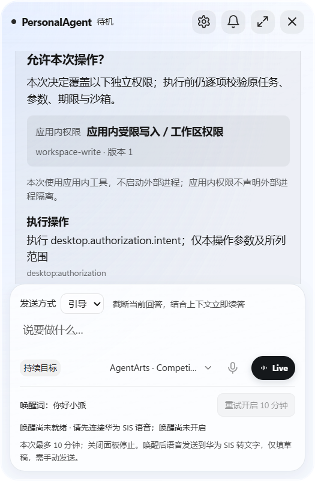
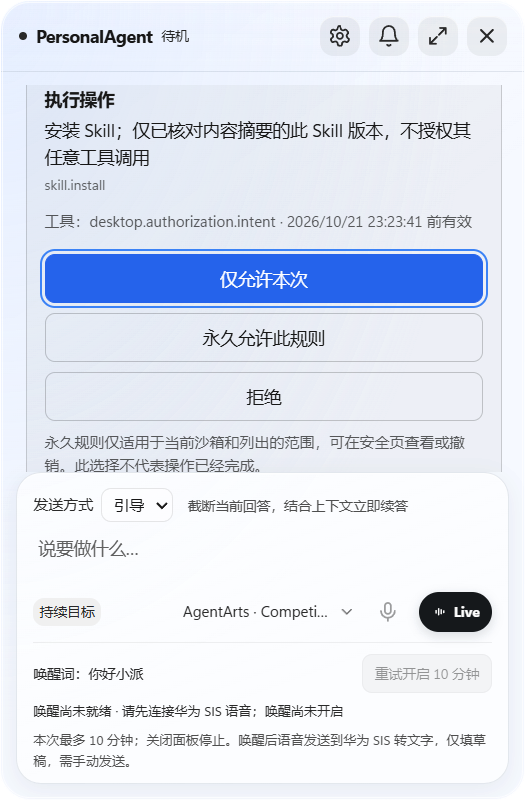
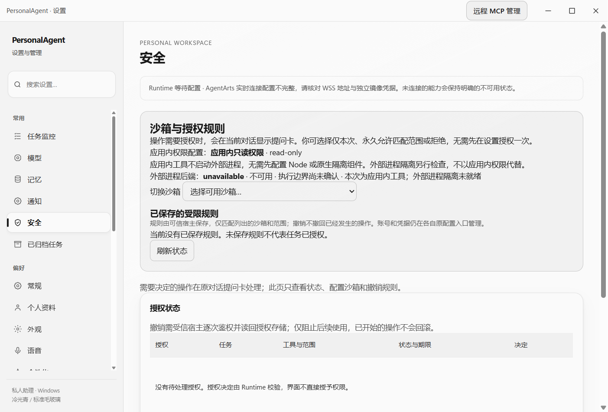

# Stop/Steer/Queue 合入后的授权卡短复核（2026-10-21）

准确实际源：`186aaac68debcdd824489689ba22a2828c027f9a`，Competition Profile。该统一树已正常合入主线 stop/steer/queue，生产 Main/Renderer 为 `66b40e14` 的组合；本轮没有修改生产或原测试文件，也没有回退发送方式/停止/排队 markup。

## 执行边界

- 复用原 `apps/desktop/test/authorization-question-product-smoke.cjs`，仅 `PA_AUTH_RENDER_ONLY=1`。真实 Electron 44.2.0 / Main / TaskRuntime / Policy / Preload / Renderer，只有 Skill 与 transport guard 为隔离 Synthetic；新建独立 profile，不访问用户 App/账号/模型。
- 使用统一树自己的依赖和构建产物，owner 确认主线增量没有 TS/依赖变更，没有借其他树 dist。Node 24.15.0；Browser plugin not available，继续仓库原 Playwright/Electron 验证路径。
- 原脚本是 `focus()+Enter`，不能称其覆盖真实 Tab。仅在 ignored observer 副本补[真实 Tab 观察片段](authorization-post-stop-render-20261021/tab-observer-fragment.txt)，不修改生产交互或增加业务授权。
- 原脚本字节 SHA256：`430952fb1e88b95076236ecebe5f7043cbe1ea9dc9acd8693bf8693c8f7e8368`；完整 observer 副本字节 SHA256：`a71ab15fbfa9f3aae6f8b09aabcedd7f6f9f6c009eafc24a22ff75291b8469aa`。除该片段外，原 once/首屏/sourceApprovalId/Settings 与关闭流程不变。

## 结果

一次执行退出 0（约 8.55 秒）；[原安全回执](authorization-post-stop-render-20261021/receipt.json) 保留实际 head。执行前后统一树 HEAD 相同、工作树 clean，自有 Electron 在 finally 中关闭。UI 槽已直接交下一负责人，本轮未运行 PSEC、模型、音频、业务账号、四次模型请求或整个永久规则矩阵。

| 受影响检查 | 实际结果 |
| --- | --- |
| 初次 pending 发现 | 新卡标题 boundingRect 在 `.thread` 首屏；实际 PNG 人工查看可读，长卡保持线程内滚动。 |
| 真实 Tab / Shift+Tab / Enter | 从卡标题依次 Tab 到 allow_once、allow_always、deny，逐一核 document.activeElement；Shift+Tab 返回 once，再 Enter 一次完成原操作。 |
| 同一卡片 | 真实 sourceApprovalId 对应旧卡无第二组批准按钮，pending 仅一项；解决后的按钮禁用。 |
| 本次与设置 | 一次批准没有新永久规则；Settings 仅 profile/规则状态与撤销，没有第二个允许步骤。 |
| 主线 UI 保留 | 截图可见新增“发送方式 / 引导”控件；本轮没有改它或宣称重新验证全部停止/排队业务语义。 |
| 错误与外部调用 | Renderer pageerror=[]、fetchCalls=0、MessageBoxes=0；models/accounts/microphones 均 0。fetch/原生第二框 guard 在 import Main 前安装。 |

本次只对首屏、键盘和安全页作新增复核；之前 `71ab24eb` 的视觉失败与 `fe0149c6` 修复回执继续保留，不回写旧失败。真实模型/云/账号、物理多屏/DPI、安装包、原生命令和全套业务矩阵未由本记录验证。没有像素级 Codex/GPT 参考证据，不声称像素一致。

## 截图

实际 PNG 编码尺寸为面板 525×800、安全页 1402×953；这里只记录捕获图像像素，不将其冒充独立 CSS viewport/DPI 测试。

