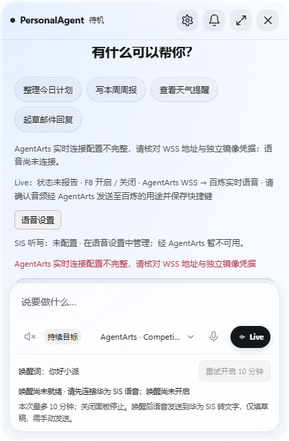
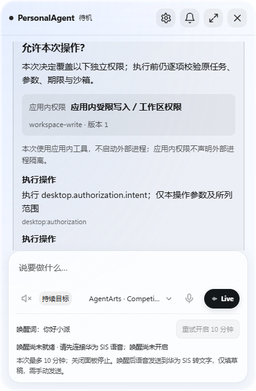
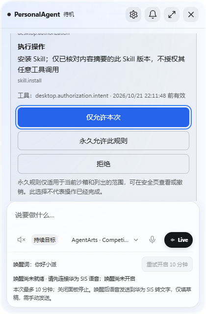
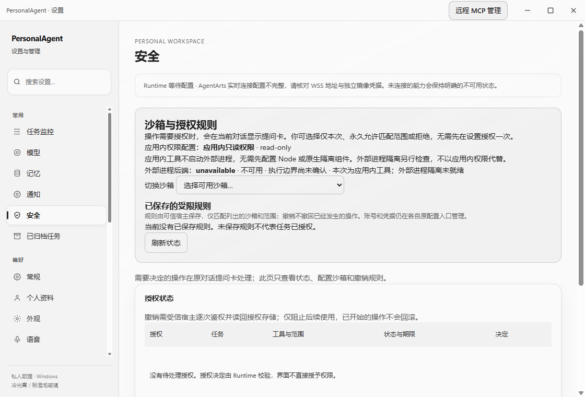

# 统一授权卡与安全页实际渲染复核（2026-10-21）

目标 Profile 为 `huawei_ict_agentarts`。使用隔离 profile、Synthetic Skill、真实 Electron Main / TaskRuntime / Policy / Preload / Renderer；没有模型、账号、麦克风或业务外发。此记录不是 AgentArts、真实连接器或 OS 隔离验收。

Browser plugin not available；依照 `frontend-testing-debugging` 使用仓库现有 Playwright / Electron 路径。Electron 44.2.0、Node 24.15.0，复用本集成树实际构建的依赖产物；没有借用其他树生产 dist、安装浏览器或修改用户设置。仅检查受影响的原生面板（420×640）与设置页（1120×760）。

## 分轮结果与修正

| 轮次 / 实际源码 head | 结果 | 精确边界 |
| --- | --- | --- |
| 首轮 `71ab24eb` | fixture 拒绝 | Synthetic Skill 目录与 frontmatter 名称不匹配，原校验在建任务前拒绝；只读本隔离数据库确认 0 task / approval / checkpoint。修正夹具名称，没有弱化产品校验。 |
| 修正 fixture 后 `71ab24eb` | 业务交互 pass，视觉 fail | 一次、永久、拒绝、同范围复用、撤销、切 profile 失效、新任务重新问与旧 revision 拒绝通过；0 pageerror / fetch / 第二 MessageBox。但截图表明初次 pending 卡在视口外，CSS-visible locator 不能证明首屏可发现。 |
| 合入 `654f3d42` 后 `fe0149c602244180cbc65bcb73cbb45587d43505` | 受影响渲染 pass | 仅重跑首卡发现、键盘一次操作、无永久规则及安全页；真实标题 boundingRect 位于 `.thread` 首屏，截图人工检查通过。没有重复整个已通过业务矩阵。 |

原始回执保存在 [renderer QA 文件夹](authorization-renderer-20261021/)。`interaction-before-visibility-fix.json` 中 `state: passed` 只表示该脚本当时的业务断言通过；本记录保留独立截图发现的视觉失败，不把旧结果回写成视觉通过。

## 已验证的交互

- 默认无已保存规则时，从实际设置页安装 Synthetic Skill，进入当前对话的一张问题卡。真实原 `sourceApprovalId` 对应的旧审批不再提供第二组批准按钮。
- 三选项为“仅允许本次 / 永久允许此规则 / 拒绝”。Enter 与 Space 均经真实安全 IPC 回传原 questionId、revision、decision；未收到成功回执前不伪画完成。一次不会新增永久规则。
- 永久规则可对同范围下一次操作复用；安全页撤销后再次出卡。切 profile 后旧卡 stale、按钮禁用，下一次需新卡；旧 revision 拒绝。
- 新 pending 只通知一次可发现性，不抢键盘焦点；Renderer 等原 follow-scroll 完成后定位当前卡标题。相同进度快照不反复滚动，下一张卡可再次发现。该行为另有 1/1 聚焦控件回归。
- 安全页仅展示应用内 profile、实际 native 状态和规则撤销；没有先去设置“允许会话”的第二步骤。本次应用内工具明确显示不启动外部进程，native unavailable 不冒充已隔离。
- `fe0149c6` 的实际原生截图已逐张查看：首卡标题、权限和应用内说明进入首屏；键盘聚焦后操作区三按钮及范围可读；安全页未出现配置异常覆盖层或重叠。原有长卡保持线程内滚动，没有额外悬浮卡。
- 两轮成功回执均为 0 Renderer pageerror、0 fetch、0 原生第二确认框。fetch/MessageBox guard 在 import 真实 Main 前安装。测试自有 Electron 在 finally 中关闭，未操作用户现有 App。

## 可重复命令

在 Node 24.15.0 环境、依赖已构建的集成树中运行；测试自行创建 ignored cache 的独立 profile，二进制路径只作为测试 runtime 注入：

```powershell
$env:PA_TEST_REPOSITORY = '<当前集成树>'
$env:PA_TEST_ELECTRON_EXE = '<Electron 44.2.0 可执行文件>'
node apps/desktop/test/authorization-question-product-smoke.cjs

# 仅在首屏修复后复核受影响表面；不重复永久/撤销业务矩阵
$env:PA_AUTH_RENDER_ONLY = '1'
node apps/desktop/test/authorization-question-product-smoke.cjs
```

脚本：[authorization-question-product-smoke.cjs](../../../apps/desktop/test/authorization-question-product-smoke.cjs)。首轮与业务轮在 `71ab24eb` 执行；最后 render-only 在 `fe0149c6` 执行并退出 0（约 3.37 秒）。完整依赖构建与 Runtime 组合证据由集成负责人另记，不在本记录重复计数。

## 截图

首轮业务脚本 CSS-visible 断言通过但实际卡未进入首屏（保留失败证据）：



修复后新卡标题和权限说明进入首屏：



键盘聚焦操作区，可继续 Enter 一次批准：



安全页只展示配置与可撤销规则，不再提供第二次允许操作：



## 未验证项

没有像素级 Codex/GPT 参考实现证据；本次自实现提问交互，不声称像素一致。没有测试其他屏幕尺寸、物理键盘设备、模型、云、真实业务数据、真实 native 命令或安装包。Synthetic Skill 仅安装/启停管理，不执行其内容。完整仓库 CI 和最终统一 PR 审查独立进行。
