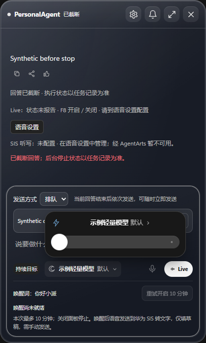

# 模型选择、授权目的地与停止主线的最小组合验证

这是明确的跨 PR 手动集成测试，不是 standalone #491 或 #484 默认 CI 已运行的声明。代码位于 `tests/manual/desktop/model-thinking-authorization.compat.mjs`，需要两个 PR 的公开 Runtime 端口及真实 Desktop question host 已正常合并；未合并的主线不能借 skip 冒充通过。

## 固定来源与准备

先核 live #491 `db87cbd7`、#484 `e7607ecb`、main `178c9e8e`，新隔离树 `.worktrees/model-picker-authorization-compat` 普通合并，无 force。Main/Renderer 自动合入；接口目录两段前置文字冲突保留两段。组合 `0b8e6b75` 的显式手动测试 **1 pass / 0 fail / 0 skip**。

随后 main 实际前进到停止/引导/排队 `f89de58a`。#491 正常合并它，模型控件仍 mountModelThinkingPicker，会话失效交给原控制器 generation；保留新主线 truncatedOutput 映射、已截断任务过滤及 reconciliation blockedReason 按钮保护。三方隔离组合只并列保留 Main 环境/交付/核实 import、Renderer 授权卡/消息队列 import，并将原授权卡去重与截断空 markup 合并。没有新授权或宽化 scope。包含该 main 的 `1c543907` 同一手动测试再 **1 pass / 0 fail / 0 skip**，没有将旧 head 的绿移植为新组合已验。

依赖使用本树离线 npm ci --ignore-scripts，初次 workspace 链接受沙箱 EPERM 后普通用户重试。对 Desktop 30 包闭包逐一比较生产构建输入与已有已验证树 `2a2075dd`，公共 package/lock/tsconfig 及各 workspace 生产输入相同后，复制并 hash 核对 568 份产物到独立树；Runtime 再从本组合源码单包构建。首次错误地在复制结束前启动编译产生缺模块准备错误，补齐后单 Runtime 构建通过；夹具最初的 namespace 空格也被原 Runtime 拒绝，修正格式后才执行成功。没有更改生产校验或用不符源码的旧 dist 代验。完整输入散列与日志散列见[安全回执](MODEL_THINKING_AUTHORIZATION_COMPAT_20261021.receipt.json)。

## 实际行为

真实使用 createRuntimeApplication、TaskRuntime、Policy、ToolGateway、AuthorizationQuestions/host、Todo 模块和原 readDesktopExecutionModel/defaultThinkingSelection。Synthetic 仅 coordination 提案、用户答案、合成待办内容和 Fake 加密存储；没有真实模型、账号或 AgentArts 请求。

1. 默认轻度解析配置的 Qwen/max，写入原 execution-model。批准前无业务执行/导出；同一卡包含 tool、connector_session、export。
2. once 后只执行/导出原 run，确认原问题、原结果 hash 的精确 lease，Policy 次数归零；重复原答案拒绝。切 manual DeepSeek/high 后原任务模型目的地不变，新任务目的地及 export rule 改变，旧 once 不放行。
3. manual 的永久决定可为相同工具/资源/目的地的下一个操作派生新精确 grant/lease；不是重复旧 run。切回 Qwen 必须重新提问，未获新许可前零新增执行/导出。
4. 同 manual 模型下换 todo.list，工具与 scope 不同仍重新提问；create 的永久许可不扩大到整段对话的任意工具。共 5 个任务、3 个 confirmed 工具/精确导出、4 张实际卡。原 Settings/sessionAllowed 始终 false，全局模型偏好不变。

## 最小复现与边界

在独立树正常合并两个来源及需要验证的 main，按回执比较构建输入并准备本树产物后执行：

```powershell
node --test --test-concurrency=1 --test-reporter=spec tests/manual/desktop/model-thinking-authorization.compat.mjs
```

该手动 case 不替代两 PR 各自当前 head 的 required CI、正式非作者审查、实际 UI/PSEC 或真实云验收；不启用/关闭 auto，不操作 queue 或合并 PR。最初 #491 的 bff06880 完整 UI/72 项证据继续保留其实际固定来源，后续新主线仅补冲突所影响的最小交互检查。

## 新停止主线的聚焦渲染补验

隔离组合普通合入 #484 保存源 `186aaac6`，最终 `2de44c1e`。模型/工作区偏好及停止反馈三文件 **30/30 pass、0 skip**；没有重跑原 72 项或四个产品模型请求。

`PA_PICKER_STOP_QA=1 node apps/desktop/test/model-thinking-renderer-smoke.cjs` 只执行一个新增场景：真实合并 Renderer + Synthetic bridge 下，运行时入队不提前 submit；点击可见统一停止按钮，经真实 `conversation.interrupt` IPC 名保留暂停草稿；迟到输出保持截断；模型选择与 Fast 仍可保存，每表面一个滑块，页面/console 错误 0。首次夹具误用隐藏的历史 #stop，再误等旧 task.cancel 路由产生 timeout；仅修测试以使用可见 #send[data-mode=stop] 与原 conversation.interrupt，没有改产品或 force 点击。原失败日志散列保留。

本次只启动一个短浏览器场景，没有 Runtime/Provider/PSEC 或真实账号调用；finally 已关闭自有浏览器/服务。实施者实际查看截图，队列仍可见，页面显示已截断，模型标题和 Fast 状态正常。公开图是原始安全 Synthetic 图，保留 hash；这不是再次完整产品验收。


