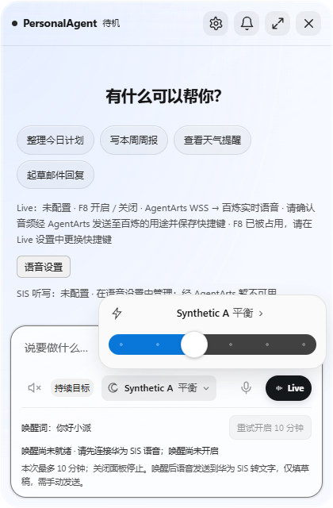
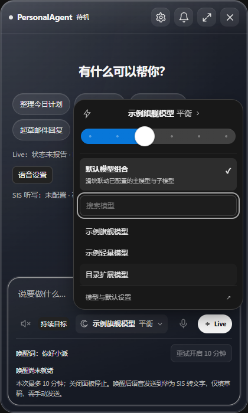
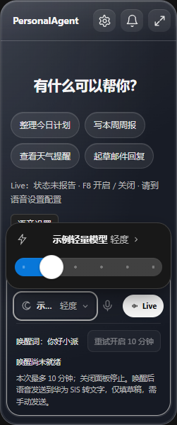
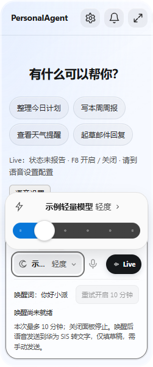
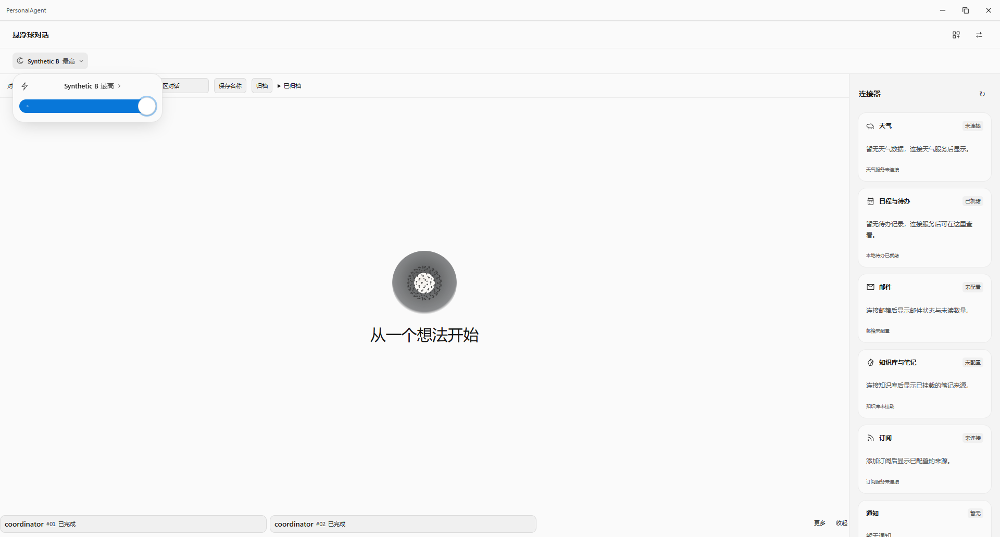

# 模型与思考入口：独立视觉复核（2026-10-21）

固定来源 head：`bff0688008afa681d1b8e0e27643d4fb398b3dc7`。目标 Profile 为 `huawei_ict_agentarts`。本记录为独立 worker 对实施者已有实际截图、回执及相关测试步骤的只读复核，**没有重新运行 App、浏览器、四次请求矩阵或构建**；不是正式 GitHub Approve。

未发现所审查表面的视觉阻断，无需追加 Electron。没有修改 picker、Main、Renderer 或任何生产文件。现有图中可见 PersonalAgent 页面标题与有意义内容，没有空白页或框架异常覆盖层。

## 证据分层

| 表面 | 原实施者实际执行 | 本次独立检查 |
| --- | --- | --- |
| Product | Electron 44.2.0、真实 Main / Preload / Runtime、隔离 profile；仅 fetch 为显式 Synthetic | 5 张原生产品 PNG 和原 result；真实模型调用为 0。不能把 Synthetic transport 说成远端模型验收。 |
| Renderer | 实际面板/工作区 Renderer 与 CSS，显式 Synthetic bridge；Runtime 未执行 | 8 张 PNG、renderer-result 与脚本断言；不能与 Product 回执合成同一次完整运行。 |

Browser plugin not available；原执行沿仓库已有 Playwright/Electron 路径。独立复核只调用本地图片查看与文件读取，没有新增浏览器依赖。原回执中的私人绝对缓存路径不复制到公开 Evidence；[独立元数据](MODEL_THINKING_PICKER_INDEPENDENT_VISUAL_QA_20261021.json) 只保留固定 head、白名单摘要、图片叶名/尺寸/SHA256。

## 视觉与交互证据

| 检查 | 结论与依据 |
| --- | --- |
| 紧凑入口和标题 | Product 420×640 面板可见模型名、思考级别和下拉箭头；Renderer 紧凑入口裁图文字清楚。窄窗入口长名称截断为省略号，完整标题保留在弹层，没有横向溢出。 |
| 唯一粗滑块 | Product 与 Renderer 的面板/工作区截图均只出现一个思考滑块；没有并列的独立 steps/budget 控件。唯一控件的 DOM 数量另由原脚本断言。 |
| 模型小箭头与搜索 | 420×700 Renderer 图显示小箭头展开后的“默认模型组合”、搜索框与模型清单；搜索框有可见焦点环。原脚本实际填充“扩展”并核可见结果、清空恢复。 |
| 原生参数与默认组合 | 原 Product 回执保留四次 Synthetic 请求：手动 high 两次、默认组合 max 两次，并断言全局配置不变；本次未重新请求或外推为真实模型行为。 |
| 251px 窄窗 | Renderer 深浅主题和 Product 窄窗图中，单滑块弹层在窗口内，模型/级别/小箭头、滑块和焦点边框可读，没有左右裁切；原脚本核 boundingBox。**该组只捕获单滑块弹层，不能声称 251px 展开的完整搜索清单已验。** |
| 深浅主题 | Renderer 的窄窗 dark/light 图提供直接对照，正文、模型标题与轨道对比可辨；Product 窄窗为浅色产品证据，不借其文件名推断暗色已测。 |
| Workspace | 原产品 1920×1032 与 Renderer 1000×760 图中模型标题、最高级别与单滑块可见；弹层没有遮住自身入口或越出窗口。 |
| 键盘和失败反馈 | 原 Renderer 脚本实际检查 slider Home/End、Escape 关闭后焦点回入口、保存失败保持原值和重试成功；原回执 errors 为 0。本次只核既有脚本/回执及焦点截图，没有独立重放键盘。 |
| Console 与结束 | 两份原结果均为 passed / errors=[]，Product realModelCalls=0，Renderer runtime='not exercised'。实施者确认自有 Electron/浏览器已关闭，本次没有新增进程。 |

## 原文包边界

在该固定 head 相对当前主线 `178c9e8e0b4c499e8bfd25820f60bd1501e4146f` 静态检查以下五个文件，`git diff origin/main...HEAD -- <files>` 无输出：AgentArts prompts、Live Voice host、Runtime subagent host、mail-analysis host、原 Live Voice test。没有把 JARVIS 原文包混入 picker 工作包；截图也只有 Synthetic 名称/公开空状态，没有真实模型配置、账号或私有路径。

## 可复查入口与限制

原实施者脚本为 `apps/desktop/test/native-reasoning-slider-smoke.cjs`（实际 Product）及 `apps/desktop/test/model-thinking-renderer-smoke.cjs`（Renderer + Synthetic bridge）；构建/72 项聚焦测试由实施者另记，本次不重复计数或代签。[实施者脱敏回执与源/图 hash 索引](MODEL_THINKING_PICKER_20261021.receipt.json) 已由原 owner 在 `96eac987` 保存，随 picker 分支统一交付。完整原图 13 份的叶名、尺寸与 hash 另经本独立 JSON 复核；下面只复制最少五张已查看且安全的原图，字节不重绘、不替换实施者原件。

真实模型/云、麦克风、账号、安装包、物理多屏/DPI 和 251px 完整展开搜索清单未由本记录验证。没有像素级 Codex 参考图，不宣称像素一致。静态或 Synthetic 检查不提升任何模型/平台接口的真实可用性。

## 最少截图

真实产品面板：

420px Renderer 展开搜索与键盘焦点：

251px Renderer 单滑块弹层，深色/浅色：

真实产品 Workspace：

