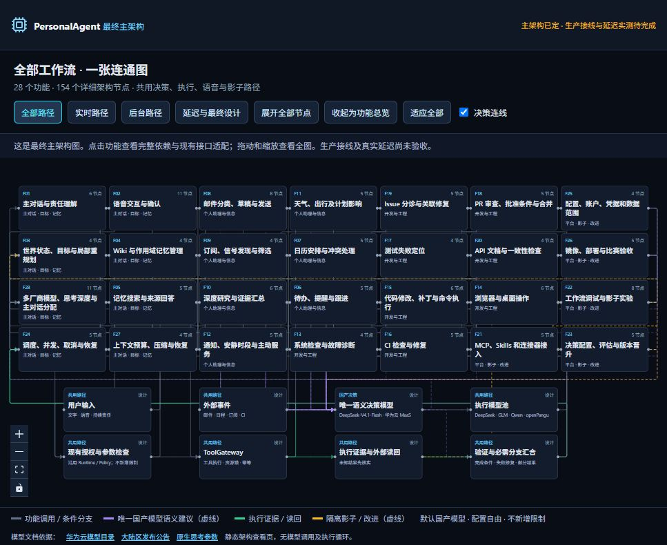

# PersonalAgent 架构定稿查看页 · 2026-10-14

目标 profile：`huawei_ict_agentarts`。这是一份可离线查看的架构页面，包含全部28个功能、185个详细节点、12个共享节点和130条跨流程关系。展开全部后共225个图节点。

架构定稿保留全部业务工作流在自有镜像，并明确AgentArts平台MCP直连、原生知识、日志/Trace及效果评估的接入。沿用2026-10-13经Astra复评的主方向；本次新增内容仍需当前PR审核和生产接线验证。此页不连接真实模型、邮箱、麦克风或账号，没有模拟执行、聊天剧本和演示成绩。

## 直接打开，不需要Node.js

- [完整主架构](DESIGN.md)、[28功能详细流程](WORKFLOWS.md)。
- [39工程模块](MODULES.md)、[重构接线与验收](IMPLEMENTATION.md)、[全仓文档清单](DOCUMENTATION_INVENTORY.md)。

下载本目录，或解压交付的压缩包后，用现代浏览器双击 **index.html**。JavaScript、CSS与图标都已打包在这个文件里，不依赖CDN、在线字体或外部资源。

GitHub的文件预览只显示HTML源码；请下载后打开，或用下面的本地服务。官方文档链接只有点击后才访问外网。

## 用Node.js运行，不需要安装依赖

运行器要求Node.js 18或以上，本次实测版本为26.3.0。在仓库根目录执行：

```powershell
cd docs/design/workflow-architecture-20261013
npm start
```

使用压缩包时，解压后进入包含本README、`package.json`和`serve.mjs`的目录，直接执行`npm start`即可；不需要再创建上面的仓库目录层级。

或者在该目录执行 `node serve.mjs`；Windows也可以双击 **启动设计页.cmd**。不要在PersonalAgent仓库根目录执行这里的 `npm start`。

打开终端输出的地址，默认：

**http://127.0.0.1:4173/architecture.html**

`/`、`/index.html`、`/architecture.html`显示同一页面。Ctrl+C停止服务。只监听本机回环地址；无需安装依赖、配置API Key或构建整个PersonalAgent。

4173被占用时自动选择空闲端口，请以终端输出为准，不会停止占用端口的其他程序。也可以在PowerShell指定端口：

```powershell
$env:PORT = '4174'
npm start
```

服务启动时读取HTML；替换页面后重启自己的这个服务，浏览器刷新即可。overview.png保留此前基础总览截图；最新平台接入节点和代码核对内容请运行index.html查看，HTTP运行器只提供离线HTML页面。

## 在页面里怎么看

- 默认总览：F01—F28与主决策、执行模型、Policy、工具、证据连接在同一图中。
- 六大板块：交互、Runtime、云编排、工具、知识记忆、评估；点击高亮并查看关联功能。只是逻辑阅读分组，不增加进程或服务。
- 核心机制：责任来源与语音、检索与上下文、局部修订与补偿、取消四种结果、模型分派与工具探索、按需影子、云端证据分工。
- AgentArts接入与代码核对：四类平台节点直接连入总图，分别查看已有实现、最小新增适配、详细流程、来源与真实验收证据。节点标为待接线，不能把架构定稿当成已部署。
- 多来源资源：知识库支持本地Wiki/Obsidian与平台/其他云提供者并存；MCP/Skill支持平台、自有及GitHub/Gitee/第三方资源，共用原宿主与执行入口。
- 点击功能或使用快速选择：查看全部节点、前置关系、条件分支、语义决策点、代码适配、恢复和验收方法。
- 展开全部节点/展开单个功能：仍在同一图中；选节点能查看输入输出、条件、汇合方式与证据要求。
- 实时/后台路径、决策连线、缩放与适应全部：便于读图。验证方案与延迟/设计状态列出测试方法和未验证项。
- 窄屏按钮栏和板块栏可横向滚动；右侧详情可纵向滚动。详情关闭后继续操作图。

## 本轮设计修订

查看器初版核对基线为main b03af83e；本次全项目文档重写核对基线为已合并#347的main 3275aa91。接口状态依据docs/interfaces/CURRENT_INTERFACE_CATALOG.md；本图不提高任何冻结或验证等级。
1. 唯一全局语义决策配置默认DeepSeek-V4.1-Flash，通过华为云国内MaaS。参与责任、记忆检索、上下文、分派、恢复、完成建议与影子选路。独立判断可并发，已有分派建议可复用。
2. 可信用户原句/有效授权是责任来源。保存版本、否定、条件和对象/参数关系；`includes`只证明字符出现，事实`rule_ref`不自动提供动作授权。明确已授权责任直接生效，不增加每条新责任首次确认。
3. 先召回再联合判断；按时间、地点、人物、资源宽松检索，未知项保留。缺证据按需扩充，不固定一跳、1–2轮或新增预算上限；相同检索无新信息时停止重复，沿用真实期限/取消/用户配置。
4. F03计划修订保留已发生效果。补偿绑定具体原operation/effect ID、读回、变更原因及修正因果链；不能凭REVISE、同对象历史写入或模型自报operation_kind分类。未知原写入先核实；现有授权覆盖补偿则自动执行，缺决定才补问。
5. F02语音与文字绑定同一当前问题、参数和revision，支持主动播报。修改使旧确认失效，已有授权仍覆盖时无需额外确认；拒绝、回声、沉默、中途转写和旧回答不会冒充同意。
6. F24操作结果区分未开始、正在停止、结果待核实、已发生。直接本地停止不等云端；口头停止仍依赖ASR。读回缺失不证明未执行，迟到返回不能覆盖新控制revision。这不是新增公共task wire终态。
7. F28主对话可分配不同厂商执行模型和实际支持的原生思考参数。执行者可以在受派范围选工具/探索，复用受限工具循环；请求仍经已有Policy/ToolGateway，不必每次工具选择串回全局模型。
8. F22仅在失败、配置变化、异常、用户调试或配置采样时触发，不默认每请求双跑。决策影子比较判断，回放不读未来、缺反事实标未知；隔离只覆盖已支持的环境，不写主任务/记忆或消费主授权。
9. F23提示/图/调用配置、用户项目补丁、可信宿主升级分别走原有测试、版本与发布。MaaS不能直接调整远端权重；AgentArts Evaluation接入仍为拟议，须真实作业读回。
10. F08授权覆盖直接执行，真正缺决定才语音补问；资料检索、分类与独立线程并行。静默徽章承载普通等待，重要副作用、截止冲击或需要决定时主动通知。
11. 全部业务编排与影子逻辑迁入自有镜像，AgentArts提供实际被调用的平台组件。复用ModelGateway、ToolGateway与现有MCP宿主，补推理Target连接配置和远程HTTPS/SSE MCP客户端，平台来源直连AgentArts MCP网关。
12. 保留本地知识实现，补KnowledgePort的云端提供者及来源映射；保留JSON角色回执、事件和Evidence，补平台日志采集与OTel Trace上报；复用现有用例、本地评分及历史平台评测集，补真实结果导出、任务与报告适配。上述平台接入尚未实现/验收，不新建第二套网关、任务库或评分系统。

默认国内服务，不新增模型封锁、角色禁用或审批门槛。执行候选包括DeepSeek、GLM、Qwen、openPangu，入口可配置；角色匹配和思考深度的效果需要相同任务实测。

## 现有代码与证据边界

基线：PersonalAgent `origin/main 3275aa91`（2026-10-14核对）。接口状态以[当前接口目录](../../interfaces/CURRENT_INTERFACE_CATALOG.md)为准。本次只改查看器，不更改公共Schema、数据库、根workspace依赖或产品Runtime。

复用TaskRuntime、ModelGateway、CloudAgentPort、Policy、ToolGateway、Evidence、MemoryQueryPort、KnowledgePort、subagentModels与subagent-host受限循环。后者提供执行者范围内探索的代码基础，不等于Competition多模型消费已验收。

责任来源映射、DecisionReady/NeedContextExpansion、隐含依赖召回、效果因果关联、完整语音/影子/上下文适配都是设计内容或拟议内部记录。图中的字段不发布新wire DTO；TypeScript接口不是安全沙箱。

自有镜像在AgentArts Runtime内承载云端业务编排，本地Runtime保有状态/控制/终态。Runtime入站WSS与本次MCP工具网关是不同入口。分别留存构建、部署、平台日志/trace、本地实际工具、读回和评估证据。平台截图或固定合成文件读取场景不能证明整链可用；Competition不静默回退Local。

本地保存不等于没有数据出机；生产模型只接收当前获授权的必要上下文。离线桌面无法执行本地动作；未来云订阅/事件收件箱须另接线。此页不提升任何能力冻结或真实验证等级。

## 可编辑源码与重新打包

`source/`是独立React/React Flow查看器，不导入生产Runtime。源码构建使用Node.js **20.19+或22.12+**（按当前Vite依赖要求）；只查看页面不需要这些构建依赖。

```powershell
cd docs/design/workflow-architecture-20261013/source
npm ci
npm run dev
```

打开Vite终端给出的地址（通常http://localhost:5173/）。依赖使用项目级华为云npm配置和已有国内镜像锁文件，不修改系统全局配置。

修改入口：

| 内容 | 文件 |
| --- | --- |
| 28个功能、节点/依赖/条件/恢复 | source/src/data/architecture.json |
| 六大板块、机制、目标与验收矩阵 | source/src/data/architectureRevisions.ts |
| AgentArts接入、代码复用核对、知识/MCP/Skill多来源 | source/src/data/agentartsIntegration.ts |
| 跨功能关系、现有接口说明 | source/src/data/overview.ts |
| 共享路径、延迟与设计状态 | source/src/data/architectureNotes.ts |
| 模型候选与原生参数说明 | source/src/data/models.ts |
| 总图及详情交互 | source/src/components/workflow/WorkflowOverview.tsx |

重新构建并更新交付页面（在source目录执行）：

文档重写验证：28功能154节点、39工程模块、PA-001—031均有映射；生成正文一致，301份变更Markdown无新增失效相对链接，未改变生产代码/公共Schema/根依赖；审查规则7项回归通过。脚本入口：

    node scripts/docs/rewrite-architecture-docs.mjs --check
    node scripts/docs/check-workflow-documentation.mjs
    node --test scripts/review/design-review.test.mjs

脚本从仓库根目录运行。导航生成器仅输出补丁；原日期的查看器构建/浏览器证据未在纯文档重写中冒充重新运行。


```powershell
npm run export:offline
npm run check:architecture
npm run lint
Copy-Item -LiteralPath ./dist/architecture.html -Destination ../index.html -Force
```

`export:offline`包含TypeScript/Vite构建；生成source/dist/architecture.html，复制后根目录index.html成为发布副本。启动器、源码及该副本一起打包给其他人。不要把node_modules、dist或本机账号配置放入压缩包。

## 验证与剩余项

- 最新网页构建、类型检查、lint和架构结构检查通过；28功能、185详细节点、40连通总览节点、130关系；离线HTML为598313字节。
- 结构检查覆盖有效依赖/边、六板块完整分组、独立停止入口、真实并行/前置关系和邮件跳过未选择语音分支。
- 此前版本已检查28功能详情、七机制、验证方案、邮件条件节点和路径高亮。最新网页实际检查四类平台面板、多来源知识/MCP/Skill、F21关联入口、全量225节点展开与收起；657×790默认浏览器尺寸下布局可操作，控制台无相关error/warn。此前1440×900及390×844检查不冒充最新版本验证。
- 本地Node运行器的HTTP/HEAD、404/405与占用端口回退验证通过；离线HTML没有外部脚本/样式资源标签。
- 浏览器插件仅允许HTTP/HTTPS，禁止file协议，因此双击离线文件未做本轮浏览器验收；可用已验证的Node回环服务查看相同HTML。
- 发布HTML与生成产物一致；本轮修改的源码与实际构建源码一致。
- 构建有单包超过500KB的体积提示，未掩盖；当前保留单文件便于离线交付。

以上是**查看器验证**。真实模型/语音/邮箱/影子宿主和工作流首响、P50/P95、调用次数、用户打扰等指标尚未由本次工作验证。公平对照用相同模型、数据、授权、幂等、读回，只改变被测机制，不填模拟成绩。


## 设计来源与审查

保留Harness任务契约、Graph Engineering真实依赖/fan-out/fan-in/局部修复、作用域记忆来源/版本/失效、失败轨迹隔离评估的方法；帖子自报性能不作为本项目成绩。

- [Harness文章](https://x.com/mirku21/article/2098836008468992471)
- [Graph Engineering文章](https://x.com/Promixyz/article/2102424036416348494)
- [作用域记忆](https://x.com/ArchimedesLore/status/2109716518837579893)
- [Opik开源仓库](https://github.com/comet-ml/opik)
- [华为云模型目录](https://support.huaweicloud.com/model-call-maas/model-call-050.html)
- [大陆区模型公告](https://support.huaweicloud.com/bulletin-maas/bulletin-maas-0001.html)
- [原生思考参数](https://support.huaweicloud.com/model-call-maas/model-call-019.html)

本轮不宣称新增机制已获Astra再次批准。PR请求goo122、Potatos498实质审核，按项目现行要求取得当前提交至少一位合资格非作者有效Approve；不会自动合并。本页修订独立于仍在审查的文档重写PR #349。
