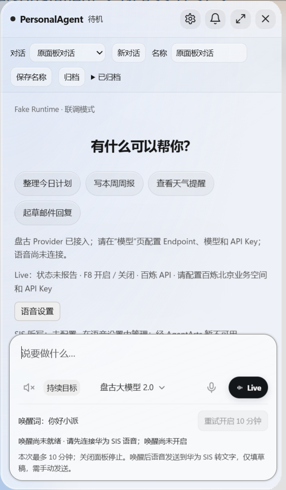
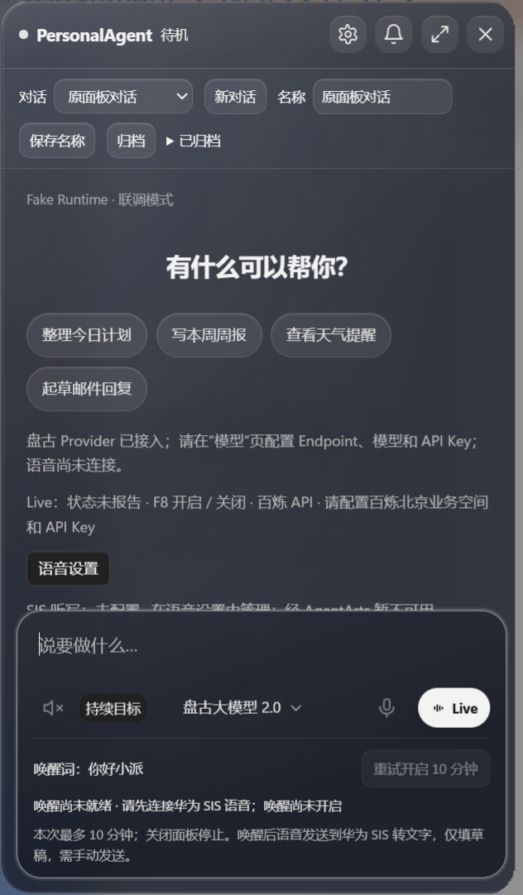
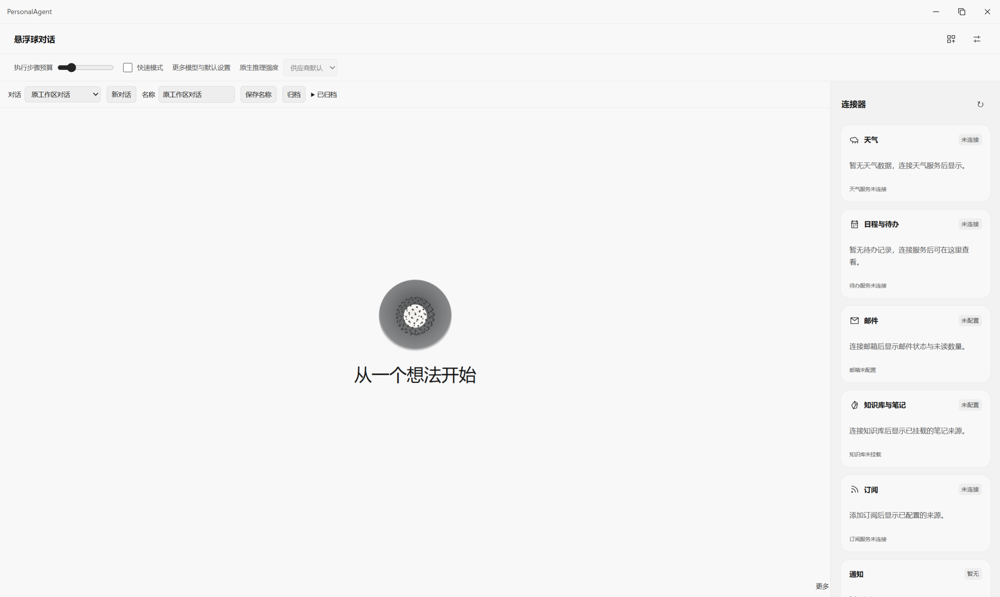
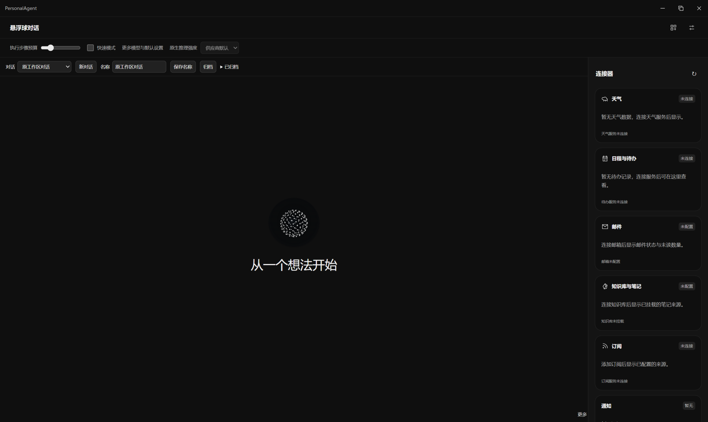

# 玻璃小面板与统一大窗口主题交付

- 目标 Profile：`huawei_ict_agentarts`；Desktop 窗口视觉工作包，状态 `review`，实际集成以 PR 为准。
- 工作树：`.worktrees/panel-glass-20261019`；分支 `codex/panel-glass-20261019`。
- 远程主线基线：`52056517`；由最新 main 建立工作树，测试期间新增的主线提交也已快进同步。
- 仅涉及 Desktop 小面板样式、窗口材质/圆角、大窗口外壳与扩大行为及相应验证；公共契约、IPC、依赖、数据库、Runtime、AgentArts 与业务执行均无变化。

## 行为

1. 面板背景使用磨砂底层、柔和光晕、双层边缘高光；输入区和按钮保留独立层次，浅色/深色主题均有清晰文字。
2. Windows 11 22H2+ 使用 Electron 原生 Acrylic。CSS `backdrop-filter` 无法单独模糊窗口外桌面内容，因此不依赖降低透明度来模拟系统磨砂。
3. 不支持系统材质、减少透明度或高对比度时，原生窗口保留不透明底色；材质设置失败也不会暴露清晰的底层文字。主题事件只在有效配置变化时更新，窗口关闭释放监听。
4. 会话控件位于标题栏下方，超量内容可滚动；对话区独立滚动、输入区固定在底部。模型/通知菜单使用不透明背景，保留原来的点击、焦点与草稿逻辑。
5. 小面板 CSS 与原生圆角统一为 24px，拖动时保持一致；原生区域随窗口尺寸刷新，避免小屏、跨显示器或尺寸变化后仍按旧区域裁切底部内容。
6. 大工作区和设置窗口使用铺满内容区域的不透明主题，取消外层玻璃描边、圆角遮罩和装饰阴影；移除这两个窗口的自定义原生裁切，保留原生缩放与窗口控制。点击小面板扩大时，工作区直接最大化至可用屏幕；还原、最小化、关闭与业务组件边界保留。

## 实际效果预览

以下为隔离 Electron 测试窗口的原生截图，背景只包含测试生成的渐变和文字。截图中使用 Fake Runtime；连接提示如实保留，不代表模型或语音服务已配置。图片随本 PR 提交，可直接在 GitHub 查看，无需访问本地缓存目录。

| 浅色 | 深色 |
| --- | --- |
|  |  |

扩大后的工作区不使用玻璃外框；以下为对应的原生内容区域截图，已排除 Windows 不可见的缩放边距和任务栏。

| 浅色工作区 | 深色工作区 |
| --- | --- |
|  |  |

## 可复现验证

环境：Windows `10.0.26300`，Node `24.15.0`，Electron `44.2.0`，锁定依赖；未更新锁文件。应用使用独立测试资料目录、显式 `--fake-runtime`，未调用真实模型、语音云服务或私人账号。

| 检查 | 结果 |
| --- | --- |
| `npm run build` | 通过 |
| `npm run typecheck --workspace=@personal-agent/desktop` | 通过 |
| `npm run check:architecture` | 3 项通过 |
| `node --test apps/desktop/test/panel-material.test.mjs apps/desktop/test/window-actions.test.mjs` | 6 项通过，覆盖系统版本/平台、辅助显示、主题变化、清理和失败回退 |
| `node --test --test-concurrency=4 apps/desktop/test/*.test.mjs` | 正常权限下 1317 项：1309 通过、8 跳过、0 失败，exit 0 |
| `node apps/desktop/test/panel-glass-smoke.cjs` | 8 组主题/尺寸/缩放通过：420×720、420×600、360×600、420×720 且 125% 缩放，各运行深浅主题；另验长草稿、菜单点击、不透明背景与草稿保留 |
| `npm run test:smoke --workspace=@personal-agent/desktop` | 通过，窗口/桥接/任务提交与取消，无页面异常 |
| `npm run test:workspace-smoke --workspace=@personal-agent/desktop` | 通过，多窗口主题/切换/对话；深浅主题下大窗口边框/圆角/阴影/模糊均为空，最大化与还原后仍铺满内容区域；工作区初始最大化且实际内容与显示器 workArea 对齐，无页面异常 |
| `npm run test:frontend-layout --workspace=@personal-agent/desktop` | 22 页、117 组窗口尺寸/缩放布局通过；最小化、最大化、还原、语言切换和设置入口通过，无页面异常 |
| `node apps/desktop/test/orb-drag-smoke.cjs` | 通过，四角边界、捕获释放、窗口打开，无页面异常 |
| `git diff --check` | 通过 |

原始截图、矩阵回执位于 `apps/desktop/.cache/panel-glass-qa/`；原生屏幕截图仅裁切隔离测试窗口，其后为测试生成的渐变和文字，不采集其他应用内容。原生截图验证了桌面文字经系统模糊、面板底部完整显示；Renderer 截图仅作为布局对照，不单独作为原生磨砂证据。

首次全量运行在沙箱临时目录执行原子 `rename` 时遭遇 `EPERM`：1317 项中 1223 通过、85 失败、9 跳过；未修改相关生产代码或断言。保留 `.cache/glass-desktop-unit.log` 和单独配置复现日志。通过授权的正常权限执行机制重跑后全量通过，日志为 `.cache/glass-desktop-unit-native.log`，耗时约 192 秒。

大窗口修复先通过新增真实 Electron 断言复现原问题：旧版本的扩大操作未进入最大化状态，`.cache/flat-shell-before.log` 保留超时失败。修复后通过，记录在 `.cache/flat-shell-after.log`；实际窗口几何和 12 次深浅主题/窗口状态外壳检查见 `apps/desktop/.cache/qa-workspace/shell-receipt.json`。全页面布局、窗口桥接、小面板回归日志分别为 `.cache/flat-shell-layout.log`、`.cache/flat-shell-bridge.log`、`.cache/flat-shell-panel.log`。

大窗口最终代码再次运行完整 Desktop 测试：1317 项，1309 通过、8 跳过、0 失败，exit 0，约 231 秒；日志为 `.cache/flat-shell-desktop-unit.log`。此后只整理文档和已生成的效果图。

材质兼容依据：[Electron BrowserWindow](https://www.electronjs.org/docs/latest/api/browser-window#winsetbackgroundmaterialmaterial-windows)。未在 Windows 10、macOS、Linux 或不同显卡实体设备逐一验收；这些环境的选择与失败回退由单元测试覆盖。不是 iOS 原生 Liquid Glass，不声明完全复现其光学效果或所有设备的性能数据。华为镜像/工作流评测不适用于本次原生 Desktop 外观改动，Fake 交互结果不代表 AgentArts 真链路验收。

恢复方式：回退本工作包提交；无迁移或用户数据变更。
